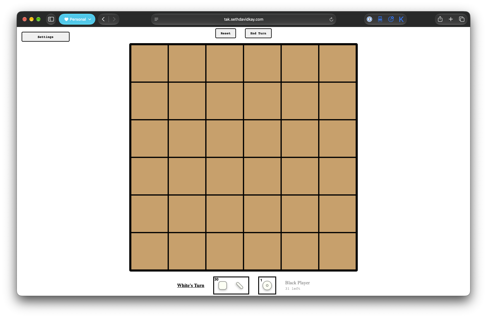

# Tak

A fully custom, fast, and intelligent Tak implementation with a dynamic bot.

---

## Table of Contents

- [Overview](#overview)
- [Rules](#rules)
- [Roadmap](#roadmap)
- [License](#license)

---

## Overview

A Tak implementation fully in C, compiled to WebAssembly, complete with a variable bot, dark mode, and more. Everything lives in your browser.

  

## Rules

See [`Rules`](rules.md).

## Roadmap
- [x] add piece count logic
- [x] add game won logic
- [x] fix overflowing of stacks into the next tile that are too large
- [x] add placing other person's tile on empty square as first turn (on first turn clicking an empty square will place a flat stone of other person's color and all other actions won't do anything)
- [x] add ability to click an empty tile and place a regular stone in it without selecitng a regular stone in the selection tool
- [ ] extract the bot js to c call into a web worker so that a new came can override an old one (not necessary, just stalls if bot is taking too long now)
- [ ] add rulebook

## License

Distributed under the GNU License. See [`LICENSE`](LICENSE) for details.
